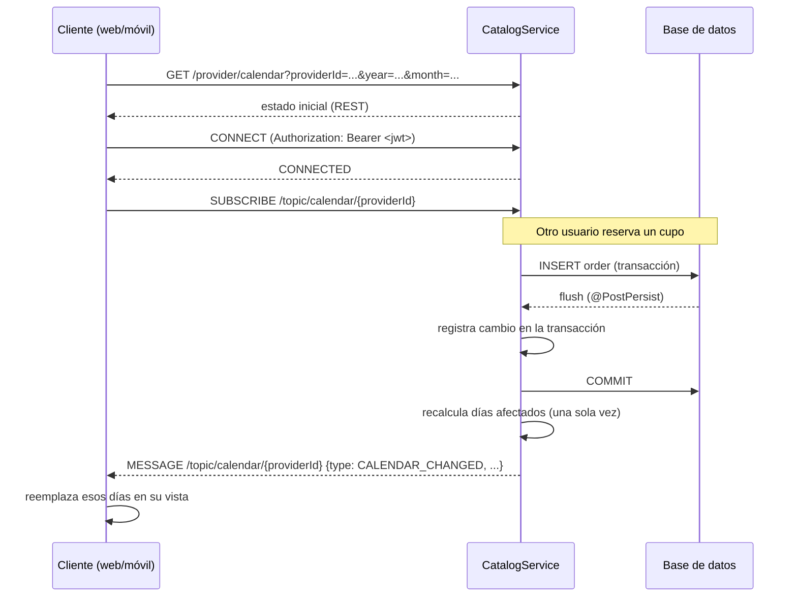

# Tiempo real en CatalogService (STOMP sobre WebSocket)

Este documento describe el canal de tiempo real del servicio: qué se publica, en qué destino,
cómo se autentica, qué garantías da y cómo escalarlo. Está escrito para que cualquier persona del
equipo pueda mantenerlo sin leer el código primero.

---

## 1. Decisión: STOMP vs SSE

Las dos opciones son válidas; la elección depende de qué problema estás resolviendo.

| Criterio | SSE (`text/event-stream`) | STOMP sobre WebSocket |
|---|---|---|
| Complejidad en Spring | Muy baja (un `SseEmitter` por request) | Media (broker, canales, autenticación de sesión) |
| Canales por tema | Hay que inventarlos (una URL por tema, un registro de emisores) | Nativos (`/topic/...`, `/user/queue/...`) |
| Fan-out a N suscriptores | Lo implementas tú (registro en memoria) | Lo hace el broker |
| Bidireccional | No | Sí |
| Proxy/CDN/infra | Funciona sobre HTTP/1.1 y HTTP/2, sin upgrade | Requiere upgrade a WebSocket (ALB lo soporta; API Gateway HTTP API no) |
| Reconexión / backoff / heartbeats | Manual | Heartbeats en el protocolo + librerías (`@stomp/stompjs`) |
| Escala horizontal | Cada instancia solo conoce sus emisores → necesitas un bus igual | `enableStompBrokerRelay` → el broker reparte entre instancias |
| Clientes móviles | OK (pero 6 conexiones por dominio en navegadores) | OK |

Para este servicio gana **STOMP** porque el caso de uso es exactamente el de un broker de
mensajes: muchos suscriptores anónimos observando un calendario, y dos stakeholders escuchando la
misma orden. Con SSE habría que reimplementar el broker a mano (registro de emisores, limpieza de
conexiones muertas, fan-out, canales privados), que es justo lo que ya hace Spring Messaging.

> Nota: el código anterior (`SseEmitterRegistry` + `OrderEventListener`) se eliminó. Sigue
> disponible en el historial de git si alguna vez se quiere volver a ese modelo.

---

## 2. Arquitectura



La idea central: **la capa de servicio no sabe que existe el tiempo real**. El disparador está en
la persistencia (`@EntityListeners`), el mensaje se arma en memoria y solo se envía **después del
commit**. Así cualquier endpoint, job o proceso nuevo que escriba en la base de datos publica
automáticamente, sin olvidar una llamada a `publishEvent`.

### Componentes

| Clase | Responsabilidad |
|---|---|
| `realtime/config/WebSocketConfig` | Endpoint, broker, heartbeats, límites de frame |
| `realtime/config/RealtimeInfrastructureConfig` | Scheduler de heartbeats y resolución de identidad |
| `realtime/interceptor/StompSecurityInterceptor` | Autentica CONNECT y autoriza SUBSCRIBE/SEND |
| `realtime/listener/RealtimeEntityListeners` | `@PostPersist/@PostUpdate/@PostRemove` → despachador |
| `realtime/RealtimeDispatcher` | Agrupa cambios de la transacción y publica en STOMP tras el commit |
| `realtime/CalendarPatchService` | Recalcula los días afectados (una vez por cambio) |
| `realtime/mapper/RealtimeMappers` | Entidades → DTOs públicos / privados |

---

## 3. Destinos y payloads

Todos los mensajes usan el mismo sobre:

```json
{
  "eventId": "8f1c...",
  "type": "ORDER_UPDATED",
  "occurredAt": "2026-11-12T14:31:02.331Z",
  "version": 1,
  "payload": { }
}
```

`eventId` sirve para deduplicar, `version` para evolucionar el contrato y `occurredAt` para
descartar mensajes que llegan tarde.

### 3.1 Calendario público — `/topic/calendar/{providerId}`

Cualquier usuario autenticado puede suscribirse (es información pública del perfil del
proveedor). **No incluye datos personales ni ids de orden.**

```json
{
  "eventId": "...",
  "type": "CALENDAR_CHANGED",
  "occurredAt": "2026-11-12T14:31:02Z",
  "version": 1,
  "payload": {
    "providerId": "prov-123",
    "reasons": ["ORDER_UPDATED"],
    "mode": "DAYS",
    "from": "2026-11-20",
    "to": "2026-11-20",
    "day": null,
    "days": [
      {
        "date": "2026-11-20",
        "available": true,
        "startTime": "08:00:00",
        "endTime": "18:00:00",
        "unavailableReason": null,
        "slots": [
          { "start": "2026-11-20T09:00:00", "end": "2026-11-20T10:00:00", "status": "ACCEPTED" }
        ]
      }
    ]
  }
}
```

`mode`:

- `DAYS` → el payload trae los días recalculados. El cliente los **reemplaza** por fecha.
- `INVALIDATE` → el cambio no tiene horizonte acotado (por ejemplo, el proveedor cambió su horario
  semanal) o cubre demasiados días. El cliente debe **volver a pedir el mes visible** por REST.

Motivos posibles (`reasons`): `AVAILABILITY_CHANGED`, `UNAVAILABILITY_CREATED`,
`UNAVAILABILITY_CHANGED`, `UNAVAILABILITY_DELETED`, `ORDER_CREATED`, `ORDER_UPDATED`,
`ORDER_CANCELLED`.

### 3.2 Calendario privado del proveedor — `/user/queue/calendar`

Mismo contrato que el público, pero cada slot trae `orderId` para que el proveedor pueda abrir la
orden directamente. Solo lo recibe el dueño del calendario.

### 3.3 Bandeja de órdenes — `/user/queue/orders`

Destino **privado por usuario** (Spring lo traduce a una cola exclusiva de esa sesión). Reciben el
mensaje los dos stakeholders: el cliente en su sesión y el proveedor en la suya, con el mismo
contenido.

```json
{
  "eventId": "...",
  "type": "ORDER_UPDATED",
  "occurredAt": "2026-11-12T14:31:02Z",
  "version": 1,
  "payload": {
    "changeType": "ORDER_UPDATED",
    "orderId": "order-1",
    "status": "ACCEPTED",
    "booking": "2026-11-20T09:00:00",
    "estimatedTime": 60,
    "reason": null,
    "createdAt": "2026-11-12T08:00:00",
    "updatedAt": "2026-11-12T08:30:00",
    "deliveryStartedAt": null,
    "clientId": "client-1",
    "clientName": "Juan Perez",
    "clientUsername": "juanperez",
    "providerId": "provider-1",
    "providerName": "Provider Test",
    "providerUsername": "providertest",
    "serviceId": "service-1",
    "startConfirmation":    { "byCustomer": null, "byProvider": null, "state": "PENDING" },
    "completionConfirmation": { "byCustomer": null, "byProvider": null, "state": "PENDING" },
    "paymentConfirmation":  { "byCustomer": null, "byProvider": null, "state": "PENDING" }
  }
}
```

`state`: `PENDING`, `PARTIAL`, `CONFIRMED`, `CONTRADICTED`, `BOTH_DENIED`.

Las confirmaciones (inicio, finalización, pago) no tienen un mensaje propio: cualquier cambio en
ellas modifica la orden, así que llega un `ORDER_UPDATED` con los tres bloques de confirmación ya
actualizados (`byCustomer`, `byProvider`, `state`). El cliente compara contra su copia y sabe quién
confirmó o negó qué.
`type`/`changeType`: `ORDER_CREATED`, `ORDER_UPDATED`, `ORDER_CANCELLED`.

El payload es **delgado a propósito**: no lleva respuestas del cliente, dirección exacta ni
requisitos. Cuando el usuario abre la orden, se pide el detalle por `GET /order/{id}`. Menos PII en
el canal, frames pequeños y una sola fuente de verdad.

---

## 4. Flujo recomendado en el cliente

1. **Suscribirse primero, consultar después.** Si se consulta antes de suscribirse, un cambio que
   ocurra entre las dos operaciones se pierde. Con `DAYS`/`INVALIDATE` el estado se reemplaza, así
   que el orden "subscribe → GET" converge siempre.
2. **Reconectar con backoff exponencial.** Al reconectar: `CONNECT`, re-`SUBSCRIBE` y volver a
   hacer el `GET` de lo que esté en pantalla (el canal no guarda historial).
3. **Deduplicar por `eventId`** y descartar si `payload.updatedAt < estado actual`.
4. **Heartbeats**: el servidor envía cada 25 s. Configura `heartbeatIncoming/Outgoing` en el
   cliente; si no llega nada en ~2 intervalos, fuerza reconexión.

### Cliente JS (`@stomp/stompjs`)

```js
import { Client } from '@stomp/stompjs';

const client = new Client({
  brokerURL: 'wss://api.fatum.example/ws/catalog',
  connectHeaders: { 'X-User-Id': currentUserId },   // ver §5 (sin auth) o Authorization: Bearer ... (con auth)
  reconnectDelay: 3000,
  heartbeatIncoming: 25000,
  heartbeatOutgoing: 25000,
});

client.onConnect = () => {
  // Calendario público de un proveedor
  client.subscribe(`/topic/calendar/${providerId}`, (frame) => {
    const { type, payload } = JSON.parse(frame.body);
    if (type !== 'CALENDAR_CHANGED') return;
    if (payload.mode === 'DAYS') applyDays(payload.days);
    else refreshMonth();               // INVALIDATE
  });

  // Órdenes del usuario autenticado (cliente o proveedor)
  client.subscribe('/user/queue/orders', (frame) => {
    const { type, payload } = JSON.parse(frame.body);
    upsertOrder(payload);              // idempotente por orderId + updatedAt
    if (type === 'ORDER_CREATED') notifyNewRequest(payload);
  });
};

client.activate();
```

Con SockJS (solo si el proxy bloquea el upgrade), usa `webSocketFactory: () => new SockJS('/ws/catalog-sockjs')`
y envía el token como `access_token` en `connectHeaders` (SockJS no permite cabeceras arbitrarias
en el upgrade).

### Cliente Android (Spring `WebSocketStompClient`)

```kotlin
val stomp = WebSocketStompClient(StandardWebSocketClient()).apply {
    messageConverter = MappingJackson2MessageConverter()
}
val headers = StompHeaders().apply { add("Authorization", "Bearer $token") }
val session = stomp.connectAsync("wss://api.fatum.example/ws/catalog", WebSocketHttpHeaders(), headers) { }.await()
session.subscribe(StompHeaders().apply { destination = "/user/queue/orders" }) { frame -> /* ... */ }
```

---

## 5. Autenticación y autorización

### Modo por defecto: sin verificación (`catalog.realtime.auth.enabled=false`)

El servicio hoy no valida tokens en ningún lado: `POST /order/book` recibe `clientId` en el body y
lo cree. Pedirle un JWT **solo** al WebSocket sería incoherente, así que el canal arranca igual:
confía en quien llama.

En este modo el cliente manda su id en el frame `CONNECT`:

```
CONNECT
X-User-Id: 3f6c1d9e-...
```

Ese valor se usa como `Principal` y es lo que hace que `/user/queue/orders` funcione. Si no lo
mandas, la conexión es válida pero **no recibirás tu cola privada** (los mensajes a `/user/...` se
descartan porque no hay destinatario).

Consecuencia: cualquiera que conozca tu API puede decir `X-User-Id: <otro>` y leer las órdenes de
esa persona. Es aceptable mientras el producto no tenga cuentas reales; **no lo es** cuando haya
datos personales de usuarios reales.

### Modo verificado (`catalog.realtime.auth.enabled=true`)

- **CONNECT** debe traer `Authorization: Bearer <access token>` (o `access_token` para SockJS).
  El token se valida contra el JWKS del User Pool de Cognito (RS256, `iss`, `exp`, audiencia
  opcional). El `sub` del token es el `Principal` de la sesión y, por tanto, el id con el que se
  resuelven los destinos `/user/...`. **Asume que `sub` == `userId` del dominio**, que es como lo
  usa hoy `UserServiceClient`.
- **SUBSCRIBE**:
  - `/user/queue/**` → permitido. Se rechaza `/user/{otroUsuario}/queue/...` (permitiría leer la
    bandeja de otra persona).
  - `/topic/...` → solo los patrones de `catalog.realtime.auth.public-topic-patterns` (hoy
    `/topic/calendar/**`).
  - Cuota por sesión: `max-subscriptions-per-session` (30 por defecto).
- **SEND** → denegado por defecto. Este servicio no consume mensajes de clientes; si algún día se
  necesita, se agrega el patrón a `allowed-send-patterns` y un `@MessageMapping`.

Se activa con una variable de entorno, sin tocar código:

```bash
REALTIME_AUTH_ENABLED=true
COGNITO_ISSUER_URI=https://cognito-idp.us-east-1.amazonaws.com/us-east-1_xxxxxxx
```

Si el borde ya valida el token (ALB + autorizador, o un gateway propio), se puede usar
`mode: GATEWAY_HEADER` con `X-User-Id`. **No lo uses si el servicio es alcanzable directamente
desde Internet**, porque la cabecera se puede falsificar.

---

## 6. Garantías y modos de falla

| Situación | Comportamiento |
|---|---|
| Rollback de la transacción | No se envía nada (el envío está en `afterCommit`) |
| Varios cambios a la misma orden en una transacción | Un solo mensaje por stakeholder con el estado final |
| Varios cambios de calendario del mismo proveedor | Un solo mensaje con la unión de rangos |
| Error al calcular el parche | Se degrada a `INVALIDATE` y se registra un warning |
| Usuario desconectado | El mensaje se descarta; al volver a conectarse consulta por REST |
| Broker caído (modo relay) | El envío falla y se registra; la escritura en BD no se ve afectada |
| Cliente lento / buffer lleno | La sesión se cierra por `send-time-limit`; el cliente reconecta y re-consulta |

**El canal no es la fuente de verdad.** Es una notificación para refrescar; la verdad está en
Postgres y se lee por REST. Por eso no se persiste ningún outbox: si se pierde un mensaje, la
reconexión + `GET` recupera el estado.

El parche de calendario se calcula **en el hilo del request**, después del commit, antes de
responder. Es una consulta por mes tocado (normalmente una), así que el costo es bajo; si algún día
se vuelve perceptible (por ejemplo, un rango de 60 días con muchas órdenes), basta con mover
`RealtimeDispatcher.flush` a un executor propio (`@Async` o un `TaskExecutor` dedicado) y aceptar
que el mensaje sale unos milisegundos después de la respuesta HTTP.

Si en el futuro se necesita entrega garantizada (por ejemplo, notificaciones push críticas), el
patrón correcto es **transactional outbox** + consumidor, no bloquear la request esperando al
broker.

---

## 7. Escalamiento

El broker simple es **en memoria**: si el servicio corre en dos instancias, un mensaje publicado en
la instancia A no llega a un cliente conectado a la B (el cliente quedaría con datos viejos hasta
reconectar). Dos opciones:

1. **Una sola instancia** (suficiente para el volumen actual) — `mode: SIMPLE`.
2. **Varias instancias** — `mode: RELAY` apuntando a Amazon MQ for RabbitMQ (o Artemis):

```yaml
catalog:
  realtime:
    broker:
      mode: RELAY
      relay:
        host: ${REALTIME_RELAY_HOST}
        port: 61613
        client-login: ${REALTIME_RELAY_CLIENT_LOGIN}
        client-passcode: ${REALTIME_RELAY_CLIENT_PASSCODE}
        system-login: ${REALTIME_RELAY_SYSTEM_LOGIN}
        system-passcode: ${REALTIME_RELAY_SYSTEM_PASSCODE}
```

Con relay, los destinos `/user/...` siguen funcionando (Spring los resuelve antes de publicar) y no
se necesitan sticky sessions.

Costos a tener en cuenta:

- Cada suscriptor recibe una copia del mensaje: 5.000 personas viendo un calendario popular = 5.000
  frames por cambio. El cálculo del parche es una sola consulta, pero el fan-out es O(N). Si eso se
  vuelve un problema, el siguiente paso es enviar solo `INVALIDATE` a los clientes que no están
  mirando la fecha afectada, o limitar la suscripción a un rango de fechas.
- **ALB**: el idle timeout por defecto es 60 s y corta WebSockets inactivos. Los heartbeats de 25 s
  lo mantienen vivo; aun así, sube el idle timeout a 300 s en el target group.
- **HTTPS en el ALB**: el mismo certificado del listener 443 sirve `https://` y `wss://`. El paso a
  paso (ACM, validación DNS, listener, Route 53, verificación y equivalentes en GCP) está en
  [alb-https-certificate.md](./alb-https-certificate.md).
- **API Gateway (HTTP API)** no soporta upgrade a WebSocket: el endpoint `/ws/catalog` necesita
  pasar por ALB/ECS (o por un CloudFront que soporte WebSocket).
- **API Gateway WebSocket API** tampoco sirve aquí: termina la conexión y entrega mensajes JSON por
  ruta, así que no puede transportar STOMP. Si algún día se migra a esa pieza, el protocolo cambia
  (JSON propio + registro de conexiones en DynamoDB + `@connections`).

---

## 8. Configuración

Todas las propiedades viven bajo `catalog.realtime` (ver `application.yaml`):

| Propiedad | Default | Descripción |
|---|---|---|
| `enabled` | `true` | Apaga el canal completo (no registra endpoint ni listeners de despacho) |
| `endpoint` | `/ws/catalog` | Ruta del handshake nativo |
| `sock-js-endpoint` | `/ws/catalog-sockjs` | Fallback SockJS (vacío = desactivado) |
| `allowed-origins` | `*` | Orígenes permitidos en el handshake (restringir en producción) |
| `heartbeat.interval` | `25000` | Heartbeats del broker simple (ms) |
| `limits.*` | 64 KB / 512 KB / 10 s | Tamaño de frame, buffer de envío y tiempo de envío |
| `broker.mode` | `SIMPLE` | `SIMPLE` o `RELAY` |
| `auth.enabled` | `false` | Valida credenciales en CONNECT (ver §5) |
| `auth.mode` | `JWT` | `JWT` o `GATEWAY_HEADER` |
| `auth.public-topic-patterns` | `/topic/calendar/**` | Topics de solo lectura abiertos |
| `auth.allowed-send-patterns` | vacío | Destinos permitidos para SEND |
| `auth.max-subscriptions-per-session` | `30` | Cuota anti-abuso |
| `auth.jwt.issuer-uri` | – | Issuer de Cognito (`https://cognito-idp.<region>.amazonaws.com/<poolId>`) |
| `auth.jwt.jwk-set-uri` | derivado | Por defecto `{issuer}/.well-known/jwks.json` |
| `auth.jwt.principal-claim` | `sub` | Claim usado como id de usuario |
| `calendar.max-patch-days` | `62` | Por encima de esto se envía `INVALIDATE` |

Variables de entorno equivalentes: `REALTIME_ENABLED`, `REALTIME_BROKER_MODE`,
`REALTIME_AUTH_ENABLED`, `REALTIME_AUTH_MODE`, `COGNITO_ISSUER_URI`, `COGNITO_JWK_SET_URI`,
`REALTIME_ALLOWED_ORIGINS`, etc.

---

## 9. Prueba manual rápida

```bash
# 1) Levantar el servicio (auth desactivada para probar sin Cognito)
REALTIME_AUTH_ENABLED=false DB_URL=... mvn spring-boot:run
```

En la consola del navegador (con `@stomp/stompjs`):

```js
const c = new Client({ brokerURL: 'ws://localhost:8080/ws/catalog',
  connectHeaders: { 'X-User-Id': 'client-1' } });
c.onConnect = () => c.subscribe('/user/queue/orders', m => console.log('orden', m.body));
c.activate();
```

Y en otra terminal:

```bash
curl -X PUT localhost:8080/order/respond -H 'Content-Type: application/json' \
  -d '{"orderId":"<id>","providerId":"<provider>","status":"ACCEPTED","estimatedTime":60}'
```

---

## 10. Decisiones conocidas / próximos pasos

- **Órdenes `PENDING` no se muestran en el calendario.** Es el comportamiento actual de
  `CalendarService` (solo pinta `ACCEPTED` y `DELIVERING`). Aunque bloquean la reserva
  (`reviewOrderOverlap`), el parche de calendario no las incluye. Si el producto quiere que el
  proveedor vea solicitudes pendientes en su calendario, hay que cambiar `CalendarService`, no el
  canal.
- **Sin historial ni "última versión".** Si más adelante se quiere que un cliente recién conectado
  reciba el estado sin `GET`, se puede añadir un `@SubscribeMapping` o un endpoint
  `GET /order/{id}/stream`-equivalente; hoy el patrón subscribe-then-fetch cubre el caso.
- **Métricas**: sería útil exponer con Micrometer el número de sesiones activas
  (`SimpUserRegistry`) y de mensajes publicados/fallidos.
- **Outbox**: solo si se necesita entrega garantizada (ver sección 6).

---

## 11. Portabilidad (AWS ↔ GCP ↔ on-premise)

El módulo `realtime` no tiene nada específico de AWS. Lo único acoplado a AWS en todo el servicio
es el consumo de SQS (`UserEventListener` con `@SqsListener`) y el starter de S3 para imágenes.

| Pieza | ¿Portable? | Nota |
|---|---|---|
| STOMP / WebSocket / broker simple | Sí | Spring puro |
| Broker relay (`mode: RELAY`) | Sí | RabbitMQ/Artemis: Amazon MQ, CloudAMQP, GCP Marketplace, Docker |
| Verificación JWT | Sí | Es OIDC estándar (Cognito, Auth0, Keycloak, Firebase, GCP Identity Platform): cambias `issuer-uri` |
| Cálculo de calendario / reglas de negocio | Sí | Lógica de dominio |
| SQS `@SqsListener` | **No** | Requiere adaptador (Pub/Sub push → endpoint HTTP, o Spring Cloud Stream con binder GCP) |
| Starter de storage (S3) | **No** | Requiere una implementación para GCS |

Notas por plataforma:

- **GCP / Cloud Run**: soporta WebSocket nativo. Con broker simple, usa `--session-affinity` o
  escala a una instancia; con varias, relay a RabbitMQ. El `--timeout` por defecto es 300 s, que
  juega a favor de los heartbeats.
- **GCP / GKE**: ingress + `cert-manager` (Let's Encrypt) da el equivalente al listener 443 del ALB.
- **On-premise**: cualquier reverse proxy con upgrade (`nginx`, `traefik`) funciona; solo hay que
  mantener la conexión viva (heartbeats) y no cerrar por idle.
